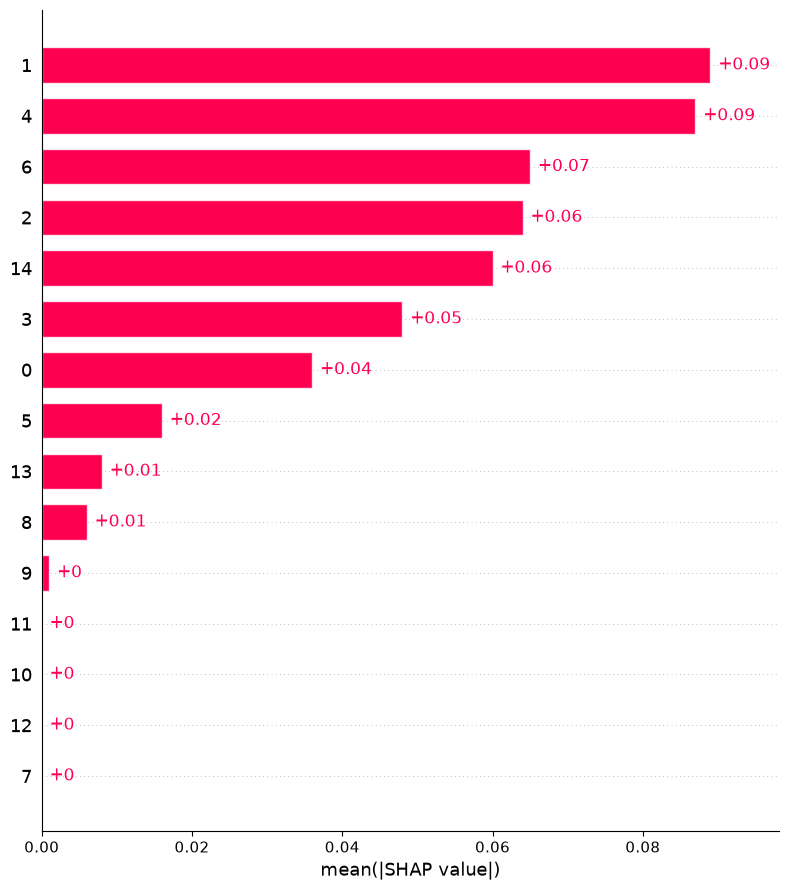
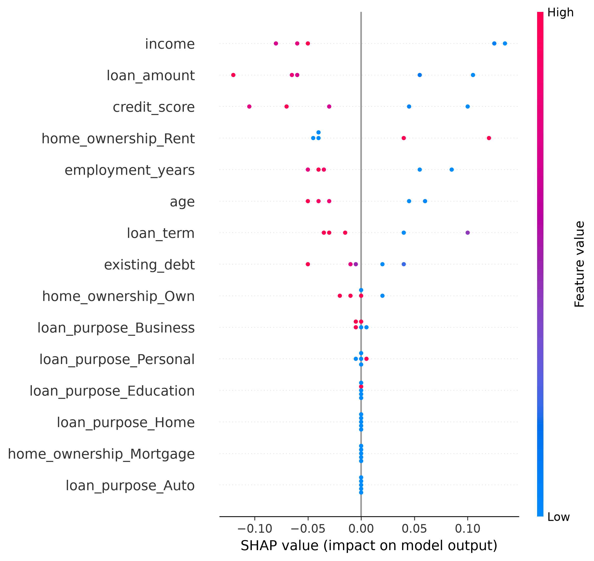

# Explainable Credit Risk Assessment System

An end-to-end machine learning project for credit-default risk classification, model comparison, and explainable AI using an interactive Streamlit application.

<p align="left">
  
  
  
  
  
</p>

> **Important:** This is an educational prototype built with a manually created synthetic dataset of 25 records. The five-row test set is too small to support reliable performance claims. The application should not be used for real loan approvals, underwriting, or other consequential financial decisions.

## Live Demo

**[Open the Streamlit App](https://harshaharshu09-explainable-credit-risk-assessment-sy-app-lbhfz0.streamlit.app/)**

The application accepts sample applicant and loan details, applies the saved preprocessing pipeline, predicts a default-risk class using the trained SVM model, and displays a demonstration loan decision together with global SHAP feature importance.

## Project Overview

Credit-risk assessment is a binary classification problem in which applicant and loan information is used to estimate whether an application belongs to a default or non-default class.

This project demonstrates an end-to-end machine-learning workflow:

- Data preparation and preprocessing
- Train/test splitting
- Multiple classification models
- Model evaluation and comparison
- Model artifact persistence with Joblib
- Interactive prediction through Streamlit
- Explainable AI using SHAP
- Global feature-importance visualization

The current Streamlit application uses **Support Vector Machine (SVM)** for inference. **K-Nearest Neighbors (KNN), Decision Tree, and LightGBM** are included for model comparison.

## Key Features

- Interactive Streamlit credit-risk assessment form
- Numeric feature scaling with `StandardScaler`
- Categorical feature encoding with `OneHotEncoder`
- Reusable saved preprocessing pipeline
- SVM-based binary credit-risk prediction
- Demonstration approval/rejection mapping
- Comparison of SVM, KNN, Decision Tree, and LightGBM
- Accuracy, precision, recall, F1-score, and confusion-matrix evaluation
- Global SHAP feature-importance analysis
- SHAP visualizations stored in the `data/` directory
- Local reproducible training and inference workflow

## Technology Stack

| Area | Tools |
|---|---|
| Programming | Python |
| Data processing | Pandas, NumPy |
| Machine learning | scikit-learn, LightGBM |
| Preprocessing | StandardScaler, OneHotEncoder |
| Explainable AI | SHAP |
| Visualization | Matplotlib, Streamlit charts |
| Web application | Streamlit |
| Model persistence | Joblib |

Dependency versions are defined in `requirements.txt`.

## Applicant Input Features

The Streamlit application accepts the following inputs:

| Feature | Description |
|---|---|
| Age | Applicant age in years |
| Monthly Income | Income value used by the sample dataset |
| Loan Amount | Requested loan amount |
| Loan Term | Requested repayment duration in months |
| Credit Score | Applicant credit-score value |
| Existing Debt | Existing debt value |
| Employment Years | Years of employment |
| Loan Purpose | Personal, Home, Business, Education, or Auto |
| Home Ownership | Rent, Own, or Mortgage |

The repository uses synthetic data, and the monetary fields do not represent a verified real-world currency or lending dataset.

## System Workflow

```text
                         CREDIT RISK ASSESSMENT SYSTEM

                              APPLICANT
                                  |
                                  v
                       Enter Applicant Details
                                  |
                                  v
                         Input Feature Validation
                                  |
                                  v
                          Data Preprocessing
                                  |
                    +-------------+-------------+
                    |                           |
                    v                           v
             Numerical Features        Categorical Features
                    |                           |
                 Scaling                One-Hot Encoding
                    |                           |
                    +-------------+-------------+
                                  |
                                  v
                        Processed Feature Data
                                  |
                                  v
                           Trained SVM Model
                                  |
                                  v
                        Credit Risk Prediction
                                  |
                    +-------------+-------------+
                    |                           |
                    v                           v
                No Default                  Default
                    |                           |
                    v                           v
                 APPROVED                    REJECTED
                    |                           |
                    +-------------+-------------+
                                  |
                                  v
                       Prediction Confidence
                                  |
                                  v
                       Explainable AI (SHAP)
                                  |
                                  v
                         Feature Importance
                                  |
                                  v
                    Key Risk-Contributing Factors
                                  |
                                  v
                         Streamlit Dashboard
                                  |
                                  v
                            FINAL RESULT
```

### Workflow Details

1. **Load data:** Read `data/credit_risk.csv` using Pandas. The target column is `default`.
2. **Prepare features:** Separate applicant features (`X`) from the target (`y`).
3. **Split data:** Use the project's stratified 80/20 train/test split with `random_state=42`.
4. **Preprocess:** Standardize numeric features and one-hot encode categorical features.
5. **Train models:** Train SVM, KNN, Decision Tree, and LightGBM classifiers.
6. **Evaluate models:** Calculate accuracy, precision, recall, F1-score, classification reports, and confusion matrices.
7. **Save artifacts:** Store trained models and the reusable preprocessor as `.pkl` files.
8. **Run the application:** Streamlit loads the saved SVM model and preprocessor for new applicant inputs.
9. **Explain the model:** SHAP analysis generates global feature-importance results and visualization files.

## Models

| Model | Role in the Project |
|---|---|
| Support Vector Machine (SVM) | Primary model used by the Streamlit application |
| K-Nearest Neighbors (KNN) | Model comparison |
| Decision Tree | Model comparison |
| LightGBM | Model comparison |

The model-comparison script evaluates the saved models on the project's processed test data. Because the test set contains only five records, the resulting metrics are illustrative and should not be treated as evidence of real-world model performance.

## Prediction Logic

The project uses the following target interpretation:

- `0` → **No Default / Low Risk**
- `1` → **Default Risk**

For demonstration purposes, the Streamlit application maps:

- **Class 0 → APPROVED**
- **Class 1 → REJECTED**

This is a prototype rule and is **not a validated lending policy**.

The SVM model also provides a probability-based confidence output. This is a model output and should not be interpreted as a guaranteed repayment probability.

## Explainable AI with SHAP

The project uses **SHAP (SHapley Additive exPlanations)** to analyze the trained SVM model.

The explainability script:

1. Loads the processed test data.
2. Loads the trained SVM model and preprocessing artifact.
3. Generates SHAP values using a permutation-based explainer.
4. Calculates mean absolute SHAP importance for each feature.
5. Saves the feature-importance table to `data/shap_feature_importance.csv`.
6. Saves the visualizations as PNG files in `data/`.

The current application displays **global feature importance** based on the synthetic test data. It is not an applicant-specific explanation and does not establish causation.

## Visual Results

### SHAP Feature Importance



### SHAP Summary Plot



These visualizations are generated from the project's current synthetic test data and are intended for demonstration and learning purposes.

## Project Structure

The following structure matches the files currently committed to the GitHub repository:

```text
Explainable-Credit-Risk-Assessment-System/
│
├── .gitignore
├── README.md
├── app.py
├── requirements.txt
│
├── data/
│   ├── credit_risk.csv
│   ├── X_train_processed.csv
│   ├── X_test_processed.csv
│   ├── y_train.csv
│   ├── y_test.csv
│   ├── shap_feature_importance.csv
│   ├── shap_feature_importance.png
│   └── shap_summary_plot.png
│
├── models/
│   ├── preprocessor.pkl
│   ├── svm_model.pkl
│   ├── knn_model.pkl
│   ├── decision_tree_model.pkl
│   └── lightgbm_model.pkl
│
└── src/
    ├── __init__.py
    ├── preprocessing.py
    ├── train_svm.py
    ├── train_knn.py
    ├── train_decision_tree.py
    ├── train_lightgbm.py
    ├── model_comparison.py
    ├── predict.py
    └── xai_explanation.py
```

## File Responsibilities

| File / Directory | Purpose |
|---|---|
| `app.py` | Streamlit user interface and SVM inference |
| `data/credit_risk.csv` | Original synthetic credit-risk dataset |
| `data/X_train_processed.csv` | Preprocessed training features |
| `data/X_test_processed.csv` | Preprocessed test features |
| `data/y_train.csv` | Training target labels |
| `data/y_test.csv` | Test target labels |
| `data/shap_feature_importance.csv` | Calculated global SHAP importance values |
| `data/*.png` | SHAP visualization outputs |
| `models/preprocessor.pkl` | Saved preprocessing pipeline |
| `models/svm_model.pkl` | Saved SVM model used by the app |
| `models/knn_model.pkl` | Saved KNN model |
| `models/decision_tree_model.pkl` | Saved Decision Tree model |
| `models/lightgbm_model.pkl` | Saved LightGBM model |
| `src/preprocessing.py` | Data splitting and preprocessing |
| `src/train_svm.py` | SVM training and evaluation |
| `src/train_knn.py` | KNN training and evaluation |
| `src/train_decision_tree.py` | Decision Tree training and evaluation |
| `src/train_lightgbm.py` | LightGBM training and evaluation |
| `src/model_comparison.py` | Compares saved model performance |
| `src/predict.py` | Command-line credit-risk prediction |
| `src/xai_explanation.py` | SHAP analysis and visualization generation |
| `requirements.txt` | Python dependencies |

## Run Locally

### 1. Clone the repository

```bash
git clone https://github.com/harshaharshu09/Explainable-Credit-Risk-Assessment-System.git
cd Explainable-Credit-Risk-Assessment-System
```

### 2. Create a virtual environment

**Windows PowerShell:**

```powershell
python -m venv .venv
.\.venv\Scripts\Activate.ps1
```

**macOS / Linux:**

```bash
python3 -m venv .venv
source .venv/bin/activate
```

### 3. Install dependencies

```bash
python -m pip install --upgrade pip
pip install -r requirements.txt
```

### 4. Run the Streamlit application

```bash
python -m streamlit run app.py
```

The application URL will be displayed by Streamlit in the terminal.

## Rebuild the Model Artifacts

Run these commands from the repository root when you want to regenerate the processed data, trained models, model-comparison results, and SHAP outputs:

```bash
python src/preprocessing.py
python src/train_svm.py
python src/train_knn.py
python src/train_decision_tree.py
python src/train_lightgbm.py
python src/model_comparison.py
python src/xai_explanation.py
```

After retraining, verify that the saved artifacts are compatible with `app.py` before deploying the application.

## Responsible Use and Limitations

- **Synthetic dataset:** The current dataset contains only 25 records.
- **Very small test set:** The 80/20 split leaves only five records for testing.
- **Illustrative metrics:** Accuracy and other test metrics are not statistically reliable with this dataset size.
- **Not for real lending:** The system should not be used for loan approval, underwriting, customer screening, or other consequential financial decisions.
- **Probability interpretation:** SVM confidence output is not a guarantee of repayment and is not necessarily calibrated.
- **Explainability scope:** Current SHAP analysis is global and based on synthetic test data rather than applicant-specific explanations.
- **Production requirements:** A real credit-risk system would require a larger, documented and appropriately licensed dataset, robust validation, probability calibration, threshold analysis, fairness assessment, privacy and security controls, monitoring, and expert review.

## Potential Improvements

- Replace the small synthetic dataset with a larger, documented, appropriately licensed dataset.
- Add stratified cross-validation for more reliable model evaluation.
- Add ROC-AUC, PR-AUC, calibration, and class-specific performance analysis.
- Add automated tests for preprocessing and prediction.
- Add applicant-level SHAP explanations.
- Add model versioning, data-drift monitoring, and prediction monitoring.
- Separate model predictions from independently validated business decision rules.
- Improve the Streamlit dashboard with additional model-performance visualizations.

## Author

**Harshavardhan Kumar**  
[GitHub Profile](https://github.com/harshaharshu09)

---

*Built as a machine-learning and explainable-AI learning project.*
